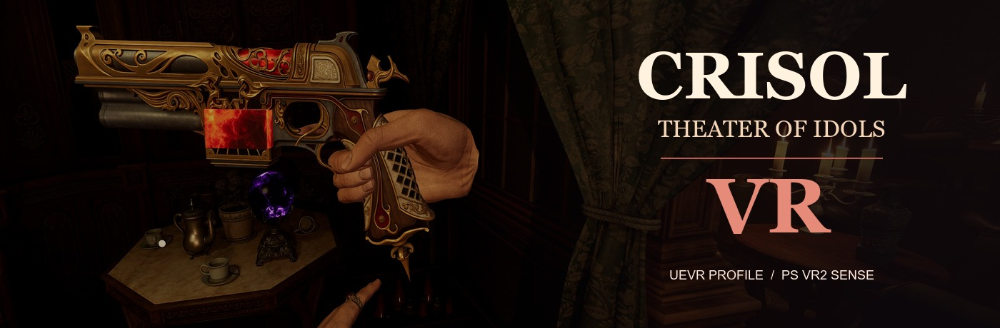
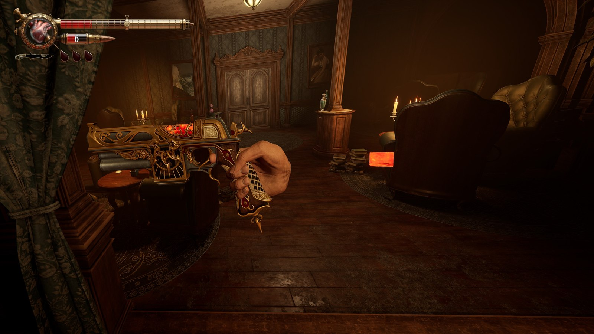
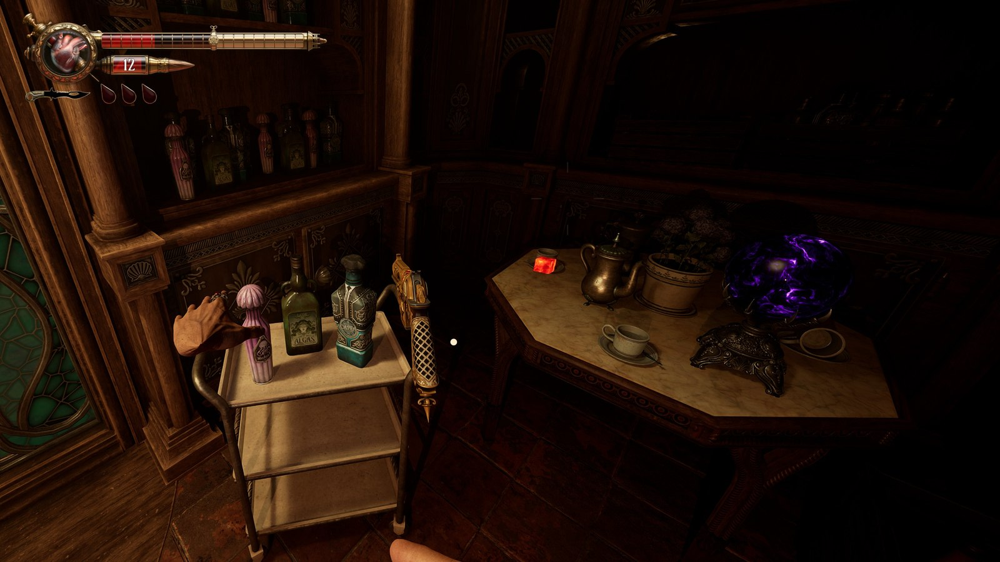

# CRISOL — THEATER OF IDOLS VR

**Unofficial UEVR profile · Tracked weapons · PS VR2 Sense support**

**[Download the UEVR profile](https://github.com/rubocopter/crisol-vr/releases/latest)** · **[Leer en español](docs/README.es.md)**

> [!IMPORTANT]
> **Early public beta (v0.1.0).** The PS VR2 Sense profile has been developed and tried in-game, but hand alignment, scripted animations, and some graphical effects still need work. The downloadable ZIP is structurally validated. A fresh-user import has not yet been independently verified.

## Features

- **6DoF weapon aiming** — The right motion controller drives the pistol's position and orientation independently of head movement.
- **PS VR2 Sense bindings** — Button, stick, trigger, grip, touch, and pose input through UEVR's Oculus Touch / OpenXR compatibility profile.
- **In-game hands** — Uses Crisol's own hand models, with experimental finger poses and a tracked weapon grip.
- **Contextual-animation handling** — Temporarily switches to the game's original hands for certain knife, blood absorption, healing, traversal, and object-interaction sequences.
- **Readable VR interface** — Health and menus stay in view while the reticle and contextual interaction prompts follow the weapon's aiming direction.
- **Head-oriented movement** — Locomotion settings favor where you look instead of leaving movement aligned to a stale body direction.

## Screenshots

## Installation

### Requirements

- A PC copy of **Crisol: Theater of Idols**.
- [UEVR by praydog](https://github.com/praydog/UEVR/releases).
- An OpenXR-compatible PC VR setup. The profile is designed around **PlayStation VR2 on PC with the Sense controllers and SteamVR**. Other controllers have not been verified.

### Import and play

1. Open **[Releases](https://github.com/rubocopter/crisol-vr/releases/latest)** and download **`CRToiPrototype-Win64-Shipping.zip`** from **Assets**. Do not download GitHub's auto-generated "Source code" ZIP.
2. In **UEVR**, use **Import Config** to import that ZIP. The file contains the UEVR profile directly at the archive root, so you do **not** need to extract it.
3. Start the PS VR2 / SteamVR environment, then launch **Crisol: Theater of Idols** on your PC. For easier switching to UEVR, prefer windowed or borderless display over exclusive fullscreen.
4. In UEVR select **`CRToiPrototype-Win64-Shipping.exe`**, choose **OpenXR**, then click **Inject**.
5. Load your save and use the Sense controllers. UEVR should apply the imported profile to the game process.

If you have already customized this game's UEVR profile, back it up before importing. UEVR's resolution scale is a starting point and may need adjustment for your GPU.

## Important profile settings

The downloadable profile already includes these settings. Keep them in place when troubleshooting.

| Setting | Profile value | Purpose |
| --- | --- | --- |
| `VR_NativeStereoFix` | `false` | Avoids the observed black-right-eye / weapon tracking problem. |
| `VR_RenderingMethod` | `0` | Rendering mode used during testing. |
| `VR_AimMethod` | `2` | Motion-controller aiming configuration. |
| `VR_MovementOrientation` | `1` | Head-oriented movement. |
| `UI_FollowView` | `true` | Keeps the general UI aligned with the headset. |
| `VR_MotionControlsInactivityTimer` | `86400` | Prevents idle input from dropping tracked weapon control during a play session. |

## Known issues

- **DLSS image artifacts in VR.** Quality and Balanced have shown flashing, brightly colored surface glitches after injection. DLSS Performance or DLAA worked better in the tested setup, with the expected image-quality/performance tradeoff. The same graphical glitch did not occur in flat mode.
- **Hand animation is experimental.** The right-hand trigger grip, left-hand rotation, hand transitions, and occasional momentary arm poses may still be misaligned. Blood cube/effect placement can drift during reload or absorption animations.
- **Performance can be demanding.** Adjust the render scale and game graphics to suit your hardware.
- **OpenXR Toolkit conflict.** An installed OpenXR Toolkit layer previously caused crashes while loading a save. Removing that layer resolved the observed issue on the development machine.
- **Controller compatibility.** PS VR2 Sense is the target. Other OpenXR controller families may need different binding profiles.

Issues and improvements are welcome through [GitHub Issues](https://github.com/rubocopter/crisol-vr/issues).

## Source and credits

The importable profile lives in [`profile/`](profile/), including settings, OpenXR bindings, Lua scripts, data and UObjectHook attachments. The ZIP is built by [`tools/build_release.py`](tools/build_release.py).

- **[praydog](https://github.com/praydog)** — [UEVR](https://github.com/praydog/UEVR), the Unreal Engine VR injector.
- **[jbusfield](https://github.com/jbusfield)** — [UEVRLib](https://github.com/jbusfield/uevrlib) and the [UEVR hands tutorial](https://github.com/jbusfield/hands_tutorial_uevr), used as the base for hand controls and Lua utilities.
- **[onitaku](https://ko-fi.com/onitaku) / [rubocopter](https://github.com/rubocopter)** — Crisol-specific profile and interaction work.

Original project code is licensed under [GPL-3.0](LICENSE). Bundled third-party UEVRLib components retain their [MIT license](UEVRLIB_LICENSE). See [Third-Party Notices](THIRD_PARTY_NOTICES.md).

**Unofficial fan-made mod.** Crisol: Theater of Idols and its artwork belong to their respective rights holders. The importable ZIP contains no game executables or extracted game assets; screenshots in this repository depict gameplay. UEVR and the game are obtained separately.

**Support development and future updates**

