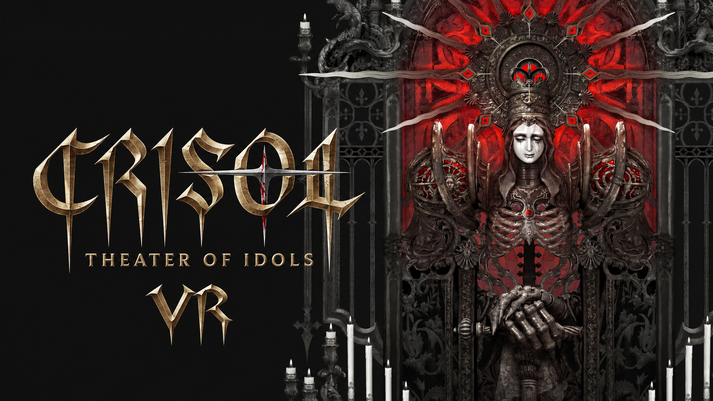

# CRISOL — THEATER OF IDOLS VR

**v1.0.1 · Unofficial UEVR profile · Tracked weapons and hands · OpenXR controls**

**[Download v1.0.1](https://github.com/rubocopter/crisol-vr/releases/tag/v1.0.1)** · **[Leer en español](docs/README.es.md)**

Play **Crisol: Theater of Idols** in VR with motion-controlled weapon aiming, the game's own hands, and a headset-following interface. The author tested **PS VR2 Sense with SteamVR and UEVR OpenXR** successfully, with acceptable performance, and published the working Sense layout in SteamVR community bindings.

See the [v1.0.1 release notes](docs/RELEASE_NOTES_v1.0.1.md) for changes and downloads.

## Gameplay preview

  

## Features

- **6DoF weapon aiming** — Aim the pistol with your right motion controller independently of head movement.
- **Native in-game hands** — Experimental finger poses, tracked weapon grip and proximity-based two-hand support.
- **Contextual animations** — Original hand animations for knife use, blood absorption, healing and traversal; tracked right-hand attachment for the walkie-talkie.
- **Head-controlled view** — Look around with the headset in menus, puzzles and object inspection while retaining controller-directed aiming during gameplay.
- **VR interface** — Health and menus follow your view; the reticle and interaction prompts follow your weapon aim.
- **Head-oriented movement** and **native PS VR2 Sense controls through SteamVR**, keeping UEVR on OpenXR.

## Installation

You need a PC copy of **Crisol: Theater of Idols**, [UEVR by praydog](https://github.com/praydog/UEVR/releases), and an OpenXR-compatible PC VR setup with motion controllers. **PS VR2 Sense with SteamVR** is the tested setup.

1. Download **`CRToiPrototype-Win64-Shipping.zip`** from the [v1.0.1 release assets](https://github.com/rubocopter/crisol-vr/releases/tag/v1.0.1). Choose the profile ZIP under **Assets**.
2. In UEVR, choose **Import Config** and select the ZIP **without extracting it**. Back up any existing custom profile first.
3. Start your headset's OpenXR runtime (**SteamVR** for PS VR2), then launch Crisol. Windowed or borderless mode makes switching to UEVR easier.
4. Select **`CRToiPrototype-Win64-Shipping.exe`** in UEVR, choose **OpenXR**, and click **Inject**.
5. **PS VR2 Sense:** in SteamVR's **Controller Bindings**, select Crisol and PS VR2 Sense, then choose the author's community layout **“Asignación compartida de Oni psvr2”**. Keep that layout selected.
6. Load your save and play.

**Importing the UEVR ZIP does not select a SteamVR controller layout.** Keep UEVR on **OpenXR** when using the native Sense layout; no Oculus conversion is needed. If the community layout is unavailable, use the [shipped native-binding guide](profile/steamvr/README.txt). The release also supplies the native Sense JSON, `Install-SenseBindings.ps1`, `Sense-OpenXR-README.txt`, and `SHA256SUMS.txt` for local setup and download verification.

When upgrading from an older profile, close Crisol and UEVR, back up and rename `%APPDATA%\UnrealVRMod\CRToiPrototype-Win64-Shipping`, then import v1.0.1. This avoids retaining old scripts. Restart the game and UEVR after changing bindings; restart SteamVR too if you changed its controller layout. A Lua reload alone does not recreate OpenXR bindings.

### PS VR2 Sense controls

Game prompts use Xbox button names:

| Sense control | Game input |
| --- | --- |
| Left / right stick | Move / turn |
| Cross / Circle | A / B — confirm / back in menus |
| Square / Triangle | X / Y |
| L2 / R2 | Left / right trigger |
| L1 / R1 | Left / right bumper |
| L3 / R3 | Left / right stick click |
| Options | Short press and release: pause / resume; hold over 0.5 s: View / Back |
| Create | View / Back through the included input helper |

For the **D-pad**, bring the left controller near the headset, then move its stick after the gesture/haptic cue. Movement axes are used for the D-pad during this gesture. The PlayStation system buttons keep their SteamVR/system behavior.

### Other controllers

These mappings have **not been tested on their respective hardware**. UEVR uses the interaction profile exposed by the active OpenXR runtime.

| Effective profile | Layout |
| --- | --- |
| Oculus Touch | Sticks; right A/B, left X/Y; triggers, grips, stick clicks; left menu for pause. |
| Valve Index | Sticks; right A/B, left A/B for X/Y; triggers, grips, stick clicks. Left trackpad press for pause; hold for View. |
| HTC Vive wands | Trackpads for movement/turn. Left bottom/right sectors = X/Y; right bottom/left = A/B; top = stick click. Left menu for pause. Clicking a pad suppresses that pad's movement/turn axes. |
| Microsoft Motion (classic WMR / compatible Odyssey profile) | Sticks for movement/turn; trackpad sectors as on Vive; triggers, grips, stick clicks and left menu for pause. |
| Khronos simple | Select/trigger and menu only; insufficient controls for full gameplay. |

The release ships **five core UEVR OpenXR overrides** plus the separate native Sense SteamVR layout. The sixteen other controller JSON templates in the source tree are inactive and excluded from the release ZIP; they do not establish compatibility. The native Sense layout uses Sony physical inputs with a UEVR-supported application profile. See the [binding guide](profile/steamvr/README.txt) for details and diagnostics.

Quest 1/2/3/3S and Quest Pro use the **Oculus Touch compatibility profile** when exposed by their OpenXR runtime. With Quest Link/Air Link or Virtual Desktop's VDXR, select **OpenXR** in UEVR and enable motion-controller streaming. With Steam Link or Virtual Desktop through SteamVR, use SteamVR as the OpenXR runtime. When the runtime exposes Oculus Touch, UEVR loads the supplied Touch override automatically. The separate Sense community layout and installer apply to PS VR2 Sense.

PICO, Vive Cosmos/Focus and other controller families can use an available runtime mapping to one of the supported profiles above. The effective runtime profile determines their controls. Headsets used with Index controllers use the Index mapping. See [controller compatibility](docs/CONTROLLERS.md) for the supported routes and current test coverage.

## Important profile settings

These values are already included. The scripts switch aiming mode between head view in menus/inspection and right-controller aiming during gameplay.

| Setting | Profile value |
| --- | --- |
| `VR_NativeStereoFix` | `false` — avoids the observed black-right-eye / weapon-tracking issue |
| `VR_RenderingMethod` | `0` |
| `VR_AimMethod` | `1` at startup/in menus; `2` during gameplay |
| `VR_AimModifyPlayerControlRotation` | `false` in menus; `true` during gameplay |
| `VR_MovementOrientation` | `1` — head-oriented movement |
| `UI_FollowView` | `true` |
| `VR_MotionControlsInactivityTimer` | `86400` — retains tracked weapon control during idle input |

## Known issues

- **DLSS artifacts:** Quality and Balanced have caused colored flashing surfaces in VR. Performance or DLAA worked better in the tested setup; adjust resolution and quality for your GPU.
- **Experimental hands:** Finger/hand alignment, animation transitions and blood effects during reload or absorption can still glitch.
- **OpenXR Toolkit conflict:** Its API layer previously caused crashes when loading a save on the development machine; removing the layer resolved that issue.
- **Validation scope:** The latest pause-menu camera and pointer/impact-alignment corrections still need headset verification.

Report problems through [GitHub Issues](https://github.com/rubocopter/crisol-vr/issues), including your headset/controllers, UEVR/SteamVR versions, selected layout and what happened. Advanced Sense setup and input diagnostics are in the [binding guide](profile/steamvr/README.txt).

To remove the profile, close the game and UEVR, then restore your backed-up UEVR profile or remove this game's profile folder. If needed, choose your previous SteamVR controller layout separately.

## Source and credits

The importable profile lives in [`profile/`](profile/), including settings, OpenXR bindings, Lua scripts, data and UObjectHook attachments. The ZIP is built by [`tools/build_release.py`](tools/build_release.py). See the [changelog](CHANGELOG.md) for version history.

- **[praydog](https://github.com/praydog)** — [UEVR](https://github.com/praydog/UEVR), the Unreal Engine VR injector.
- **[jbusfield](https://github.com/jbusfield)** — [UEVRLib](https://github.com/jbusfield/uevrlib) and the [UEVR hands tutorial](https://github.com/jbusfield/hands_tutorial_uevr), used as the base for hand controls and Lua utilities.
- **[onitaku](https://ko-fi.com/onitaku) / [rubocopter](https://github.com/rubocopter)** — Crisol-specific profile and interaction work.
- **OpenAI Codex** — assistance with code, testing and documentation.

Original project code is licensed under [GPL-3.0](LICENSE). Bundled third-party UEVRLib components retain their [MIT license](UEVRLIB_LICENSE). See [Third-Party Notices](THIRD_PARTY_NOTICES.md).

**Unofficial fan-made mod.** Crisol: Theater of Idols and its artwork belong to their respective rights holders. The importable ZIP contains no game executables or extracted game assets; screenshots in this repository depict gameplay. UEVR and the game are obtained separately.
