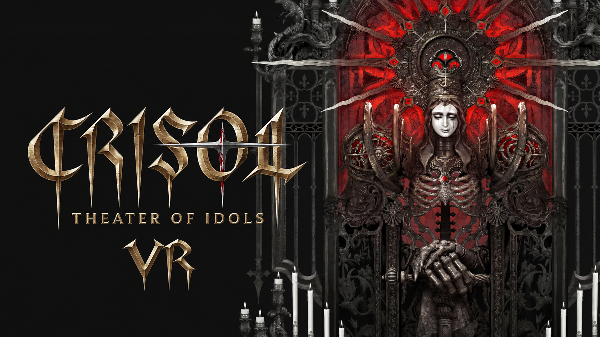
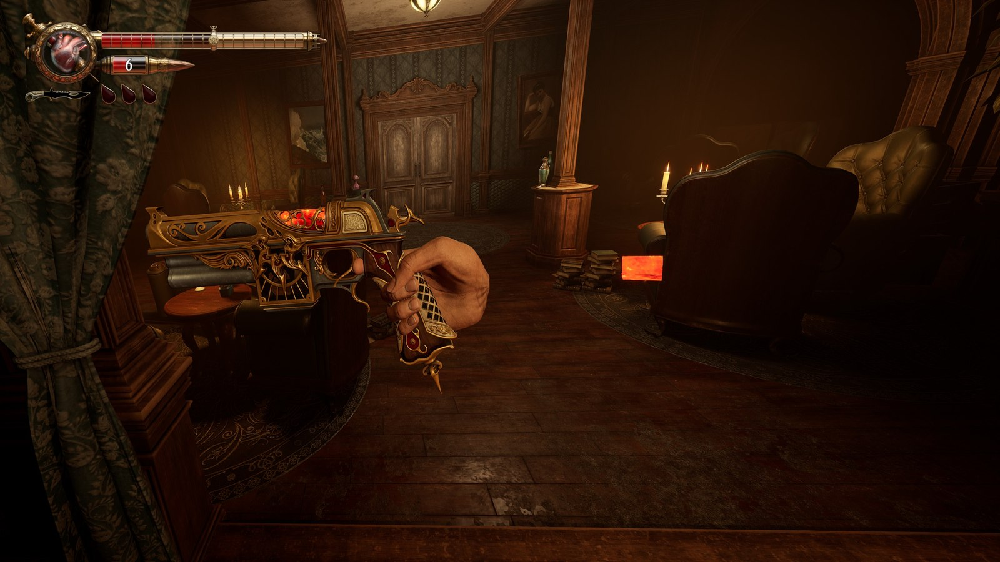
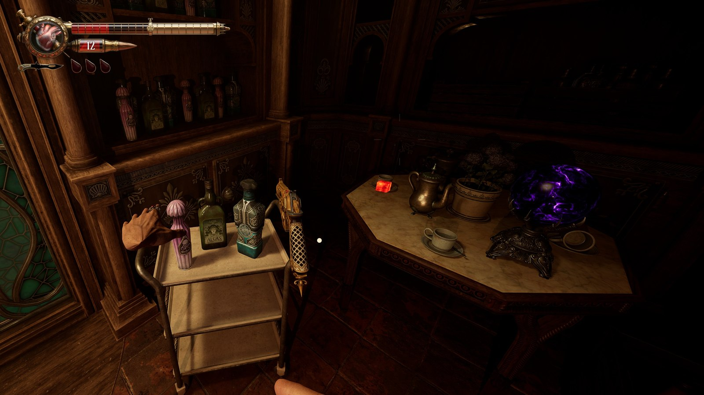

# CRISOL — THEATER OF IDOLS VR

**Perfil UEVR no oficial · Armas con seguimiento 6DoF · Mandos PS VR2 Sense**

**[Descargar el perfil](https://github.com/rubocopter/crisol-vr/releases/latest)** · **[English](../README.md)** · **[Apoyar en Ko-fi](https://ko-fi.com/onitaku)**

> [!IMPORTANT]
> **Beta pública v0.1.0.** El perfil se ha probado en el juego con PS VR2, pero todavía hay desajustes de manos, transiciones de animaciones y algunos efectos gráficos. El ZIP se ha validado estructuralmente, aunque todavía no se ha comprobado su importación desde cero en otro equipo.

## Vídeo de gameplay

  

## Qué incluye

- **Apuntado 6DoF** con seguimiento de la pistola desde el Sense derecho, independiente del movimiento de la cabeza.
- **Bindings de PS VR2 Sense** con compatibilidad Oculus Touch / OpenXR, botones, gatillos, agarre y eventos táctiles.
- **Manos originales del juego**, poses de los dedos y agarre experimental de la pistola.
- **Animaciones contextuales originales** cuando el juego bloquea las manos, como uso del cuchillo, absorción de sangre, curación, escaleras o empuje de objetos.
- **HUD adaptado** con barra de salud y menús vinculados al visor, mientras la mira y los indicadores de interacción siguen el apuntado del arma.
- **Movimiento orientado hacia la mirada** para evitar que la dirección de desplazamiento quede desfasada respecto al visor.

## Capturas

## Instalación

1. Instala el juego en PC y descarga [UEVR](https://github.com/praydog/UEVR/releases).
2. En [**Releases**](https://github.com/rubocopter/crisol-vr/releases/latest), descarga **`CRToiPrototype-Win64-Shipping.zip`** desde *Assets*. No descargues el ZIP «Source code» que genera GitHub.
3. Abre **UEVR**, pulsa **Import Config** e importa el ZIP **sin descomprimirlo**. Su contenido está colocado directamente en la raíz del archivo.
4. Inicia **SteamVR** con las PS VR2 y sus mandos Sense, y después inicia Crisol. Se recomienda modo ventana o ventana sin bordes para alternar al inyector.
5. Selecciona **`CRToiPrototype-Win64-Shipping.exe`** en UEVR, elige **OpenXR** y pulsa **Inject**.
6. Carga la partida. El perfil debería aplicarse automáticamente al proceso del juego.

Si ya tenías ajustes personalizados para este juego en UEVR, haz una copia antes de importar. La escala de renderizado del perfil es orientativa y puede necesitar ajustes según tu GPU.

## Ajustes que deben conservarse

| Ajuste | Valor | Razón |
| --- | --- | --- |
| `VR_NativeStereoFix` | `false` | Evita el ojo derecho negro y la pérdida de seguimiento del arma observados en las pruebas. |
| `VR_RenderingMethod` | `0` | Método de renderizado usado en las pruebas. |
| `VR_AimMethod` | `2` | Apuntado mediante mando de movimiento. |
| `VR_MovementOrientation` | `1` | Movimiento orientado con la cabeza. |
| `UI_FollowView` | `true` | HUD general ligado al visor. |
| `VR_MotionControlsInactivityTimer` | `86400` | Evita que el arma pierda el seguimiento tras un rato sin pulsar botones. |

## Limitaciones conocidas

- **DLSS en VR.** Las opciones Calidad y Equilibrado han provocado parpadeos y superficies de colores al inyectar UEVR. Rendimiento y DLAA dieron mejores resultados en las pruebas, con sus respectivos compromisos de calidad y rendimiento. En plano no se reprodujo el problema.
- **Manos y animaciones.** Pueden quedar desalineados el dedo del gatillo o la rotación de la izquierda. Hay transiciones con brazos colocados de forma incorrecta, y los efectos de sangre pueden desplazarse durante recargas o absorciones.
- **Rendimiento.** Es un juego exigente en VR, por lo que conviene ajustar resolución y gráficos.
- **Conflicto con OpenXR Toolkit.** En el equipo de desarrollo causó un cierre al cargar partida. Al desinstalar esa capa, el problema dejó de reproducirse.
- **Otros visores.** El objetivo principal son PS VR2 y Sense en PC. No se han validado bindings de otros mandos.

Puedes comunicar incidencias en [GitHub Issues](https://github.com/rubocopter/crisol-vr/issues).

## Créditos y licencia

- **[praydog](https://github.com/praydog/UEVR)** por UEVR.
- **[jbusfield](https://github.com/jbusfield/uevrlib)** por UEVRLib y su [tutorial de manos](https://github.com/jbusfield/hands_tutorial_uevr).
- **[rubocopter / onitaku](https://github.com/rubocopter)** por los scripts y la configuración específicos de Crisol.

El código original está bajo [GPL-3.0](../LICENSE). Los componentes UEVRLib conservan la [licencia MIT](../UEVRLIB_LICENSE). Consulta [los avisos de terceros](../THIRD_PARTY_NOTICES.md).

Mod no oficial. El juego y sus recursos pertenecen a sus titulares. Es necesario conseguir el juego y UEVR por separado.

