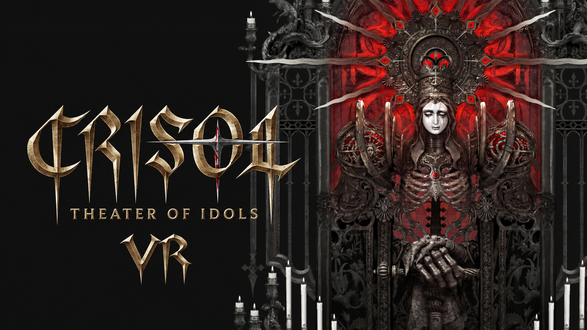
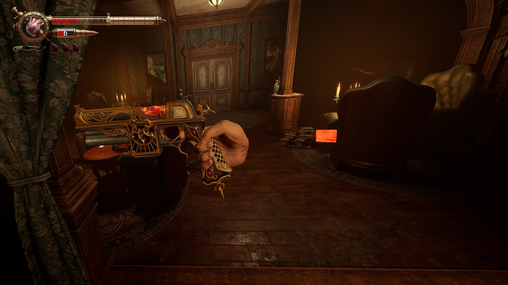
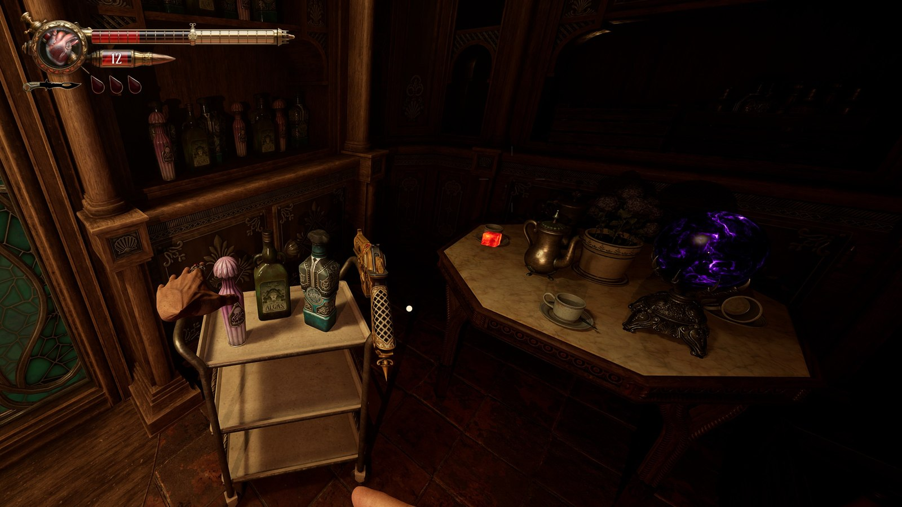

# CRISOL — THEATER OF IDOLS VR

**v1.0.1 · Perfil UEVR no oficial · Armas y manos con seguimiento 6DoF · Controles OpenXR**

**[Descargar v1.0.1](https://github.com/rubocopter/crisol-vr/releases/tag/v1.0.1)** · **[English](../README.md)** · **[Apoyar en Ko-fi](https://ko-fi.com/onitaku)**

Juega a **Crisol: Theater of Idols** en VR con apuntado mediante mandos de movimiento, las manos originales del juego y una interfaz que sigue al visor. El autor ha probado con éxito **PS VR2 Sense con SteamVR y UEVR OpenXR**, con rendimiento aceptable, y ha publicado la asignación Sense utilizada en los bindings de la comunidad de SteamVR.

Consulta las [notas de v1.0.1](RELEASE_NOTES_v1.0.1.md) en inglés para ver los cambios y las descargas.

## Vídeo de gameplay

  

## Qué incluye

- **Apuntado 6DoF** de la pistola con el mando derecho, independiente de la cabeza.
- **Manos originales del juego**, con poses experimentales de dedos, agarre y apoyo automático con la segunda mano por proximidad.
- **Animaciones contextuales** para cuchillo, absorción de sangre, curación y escaleras; mano derecha acoplada al walkie-talkie.
- **Cámara controlada por el visor** en menús, puzles e inspecciones, conservando el apuntado con el mando durante la partida.
- **HUD adaptado**: salud y menús siguen al visor; mira e indicadores de interacción siguen el apuntado del arma.
- **Movimiento orientado hacia la mirada** y **controles Sense nativos mediante SteamVR**, manteniendo UEVR en OpenXR.

## Capturas

## Instalación

Necesitas el juego para PC, [UEVR de praydog](https://github.com/praydog/UEVR/releases) y un equipo PC VR compatible con OpenXR y mandos de movimiento. La configuración probada es **PS VR2 Sense con SteamVR**.

1. Descarga **`CRToiPrototype-Win64-Shipping.zip`** desde **Assets** en la [release v1.0.1](https://github.com/rubocopter/crisol-vr/releases/tag/v1.0.1).
2. Abre UEVR, pulsa **Import Config** e importa el ZIP **sin descomprimirlo**. Guarda antes una copia de cualquier perfil personalizado que tengas.
3. Inicia el runtime OpenXR de tu visor (**SteamVR** para PS VR2) y después Crisol. El modo ventana o sin bordes facilita alternar a UEVR.
4. Selecciona **`CRToiPrototype-Win64-Shipping.exe`**, elige **OpenXR** y pulsa **Inject**.
5. **PS VR2 Sense:** en **Controller Bindings** de SteamVR, selecciona Crisol y PS VR2 Sense, y elige la asignación del autor en la comunidad **«Asignación compartida de Oni psvr2»**. Déjala seleccionada.
6. Carga tu partida y juega.

**Importar el ZIP UEVR no selecciona una asignación de SteamVR.** Conserva **OpenXR** en UEVR con el layout Sense nativo; no necesitas conversión Oculus. Si no encuentras la asignación de la comunidad, sigue la [guía nativa incluida](../profile/steamvr/README.txt). La release también ofrece el JSON Sense, `Install-SenseBindings.ps1`, `Sense-OpenXR-README.txt` y `SHA256SUMS.txt` para la configuración local y la comprobación de descargas.

Para actualizar desde un perfil anterior, cierra Crisol y UEVR, guarda una copia y renombra `%APPDATA%\UnrealVRMod\CRToiPrototype-Win64-Shipping`, e importa v1.0.1. Así evitas conservar scripts antiguos. Reinicia juego y UEVR tras modificar bindings; reinicia SteamVR también si cambiaste su layout. Recargar Lua no recrea las acciones OpenXR.

### Controles PS VR2 Sense

Los avisos del juego muestran botones Xbox:

| Control Sense | Entrada del juego |
| --- | --- |
| Stick izquierdo / derecho | Movimiento / giro |
| Cruz / Círculo | A / B — confirmar / volver en menús |
| Cuadrado / Triángulo | X / Y |
| L2 / R2 | Gatillo izquierdo / derecho |
| L1 / R1 | LB / RB |
| L3 / R3 | Clic de stick izquierdo / derecho |
| Options | Pulsar y soltar: pausa / reanudar; mantener más de 0,5 s: View / Back |
| Create | View / Back mediante el helper incluido |

Para usar la **cruceta**, acerca el mando izquierdo al visor y mueve su stick tras el gesto/señal háptica. Durante el gesto, los ejes de movimiento se usan como cruceta. Los botones PlayStation conservan su función de sistema/SteamVR.

### Otros mandos

Estas asignaciones **no se han probado en sus respectivos mandos físicos**. UEVR aplica el perfil de interacción que expone el runtime OpenXR activo.

| Perfil efectivo | Asignación |
| --- | --- |
| Oculus Touch | Sticks; A/B derechos, X/Y izquierdos; gatillos, agarres, clics de stick y menú izquierdo para pausa. |
| Valve Index | Sticks; A/B derechos, A/B izquierdos para X/Y; gatillos, agarres y clics. Trackpad izquierdo para pausa; mantener para View. |
| HTC Vive clásico | Paneles táctiles para movimiento/giro. Sectores abajo/derecha del izquierdo = X/Y; abajo/izquierda del derecho = A/B; arriba = clic de stick. Menú izquierdo para pausa. Pulsar un panel anula sus ejes de movimiento/giro. |
| Microsoft Motion (WMR clásico / perfil compatible Odyssey) | Sticks para movimiento/giro; sectores del panel como Vive; gatillos, agarres, clics y menú izquierdo para pausa. |
| Khronos simple | Solo Select/gatillo y menú; insuficiente para todos los controles del juego. |

La release incluye **cinco overrides UEVR OpenXR** y el layout Sense nativo de SteamVR por separado. Las otras dieciséis plantillas JSON del código están inactivas y excluidas del ZIP; su presencia no acredita compatibilidad. El layout Sense utiliza entradas físicas Sony y un perfil de aplicación admitido por UEVR. La [guía de bindings](../profile/steamvr/README.txt) contiene los detalles y el diagnóstico.

Quest 1/2/3/3S y Quest Pro utilizan el **perfil compatible Oculus Touch** cuando lo expone su runtime OpenXR. Con Quest Link/Air Link o VDXR de Virtual Desktop, selecciona **OpenXR** en UEVR y activa el envío de los mandos de movimiento. Con Steam Link o Virtual Desktop a través de SteamVR, utiliza SteamVR como runtime OpenXR. Cuando el runtime expone Oculus Touch, UEVR carga automáticamente el override Touch incluido. El layout de la comunidad y el instalador Sense corresponden a PS VR2 Sense.

PICO, Vive Cosmos/Focus y otros mandos pueden utilizar las asignaciones compatibles que su runtime exponga mediante los perfiles de la tabla. El perfil efectivo determina sus controles. Los visores utilizados con mandos Index emplean la asignación Index. Consulta las rutas y pruebas en la [guía de compatibilidad](CONTROLLERS.md).

## Ajustes incluidos

Los scripts alternan entre vista de cabeza en menús/inspección y apuntado con el mando derecho durante el juego.

| Ajuste | Valor del perfil |
| --- | --- |
| `VR_NativeStereoFix` | `false` — evita el ojo derecho negro y la pérdida de seguimiento observados |
| `VR_RenderingMethod` | `0` |
| `VR_AimMethod` | `1` al arrancar/en menús; `2` durante el juego |
| `VR_AimModifyPlayerControlRotation` | `false` en menús; `true` durante el juego |
| `VR_MovementOrientation` | `1` — movimiento según la cabeza |
| `UI_FollowView` | `true` |
| `VR_MotionControlsInactivityTimer` | `86400` — conserva el seguimiento del arma aunque no pulses botones |

## Limitaciones conocidas

- **Artefactos DLSS:** Calidad y Equilibrado han provocado parpadeos y superficies de colores en VR. Rendimiento o DLAA funcionaron mejor en el equipo probado; ajusta resolución y calidad a tu GPU.
- **Manos experimentales:** Pueden fallar la alineación de dedos/manos, las transiciones de animación y los efectos de sangre al recargar o absorber.
- **Conflicto con OpenXR Toolkit:** Su capa API provocó cierres al cargar partida en el equipo de desarrollo; retirarla resolvió ese problema.
- **Alcance de las pruebas:** Falta comprobar con visor las nuevas correcciones de cámara en pausa y alineación del puntero con el impacto.

Comunica incidencias en [GitHub Issues](https://github.com/rubocopter/crisol-vr/issues) e indica visor/mandos, versiones de UEVR/SteamVR, layout seleccionado y resultado. La [guía de bindings](../profile/steamvr/README.txt) contiene la configuración avanzada y el diagnóstico Sense.

Para retirar el perfil, cierra juego y UEVR y restaura tu copia anterior o elimina la carpeta del perfil de este juego. Si procede, selecciona por separado tu layout anterior en SteamVR.

## Créditos y licencia

- **[praydog](https://github.com/praydog/UEVR)** por UEVR.
- **[jbusfield](https://github.com/jbusfield/uevrlib)** por UEVRLib y su [tutorial de manos](https://github.com/jbusfield/hands_tutorial_uevr).
- **[rubocopter / onitaku](https://github.com/rubocopter)** por los scripts y la configuración específicos de Crisol.
- **OpenAI Codex** por la asistencia en código, pruebas y documentación.

El código original está bajo [GPL-3.0](../LICENSE). Los componentes UEVRLib conservan la [licencia MIT](../UEVRLIB_LICENSE). Consulta [los avisos de terceros](../THIRD_PARTY_NOTICES.md) y el [historial de cambios](../CHANGELOG.md).

Mod no oficial. El juego y sus recursos pertenecen a sus titulares. Es necesario conseguir el juego y UEVR por separado.

